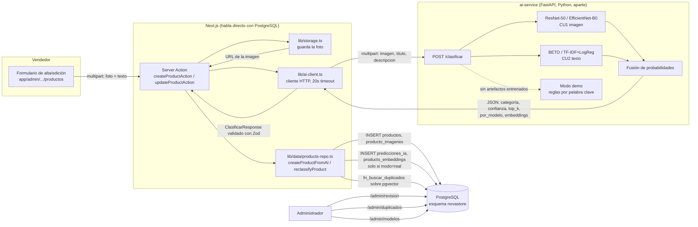

# Arquitectura del módulo de IA

Este documento explica cómo se conecta el módulo de IA (CU1 imagen, CU2
texto, CU5 duplicados) con el resto de NovaStore, y por qué se tomaron
las decisiones de diseño que se tomaron. Para instrucciones de instalar
y correr cada parte, ver `Leer.md` (frontend), `ai-service/README.md`
(microservicio) y `docs/GUIA_COLAB.md` (entrenamiento).

## Panorama general



Puntos clave de esta arquitectura:

- **Next.js nunca dejó de hablar directo con PostgreSQL.** No existe (ni
  debía crearse) un backend FastAPI intermedio para el CRUD de la
  tienda — eso sigue siendo `lib/data/*-repo.ts` con SQL directo contra
  `db/novastore_postgresql.sql`. El **único** servicio Python del
  proyecto es `ai-service/`, y su única responsabilidad es clasificar.
- **`ai-service` no es dueño de ningún dato de negocio.** No guarda la
  imagen, no sabe qué es un "producto" de NovaStore, no toca
  PostgreSQL. Recibe una imagen + texto, devuelve una predicción. Quien
  decide qué hacer con esa predicción (publicar, mandar a revisión,
  guardar embeddings) es `lib/data/products-repo.ts`, en Next.js.
- **El servicio de IA nunca bloquea al vendedor.** `lib/ai-client.ts`
  tiene un timeout de 20s y cualquier error (red, 5xx, timeout) se
  captura y se convierte en "sin clasificación" — el producto se guarda
  igual, queda en `/admin/revision` sin categoría sugerida, y un
  administrador la asigna a mano. Esto se prueba explícitamente en
  Playwright (`tests/e2e/e-panel-ia.spec.ts`, caso "servicio de IA
  caído").
- **Modo demo vs. modo real es una propiedad del servicio, no un flag
  que alguien prenda.** `ai-service` arranca en modo real si encuentra
  al menos un artefacto entrenado en `MODELS_DIR`; si no encuentra
  ninguno, arranca en modo demo (reglas de palabras clave +
  "embeddings" deterministas a partir de un hash — nunca presentados
  como reales). La respuesta de `/clasificar` siempre declara
  `"modo": "real" | "demo"`, y ese campo viaja hasta la UI
  (`AISuggestionPanel`, `/admin/revision`, `/admin/modelos`) para que
  nadie confunda una predicción de verdad con una de relleno.

## El contrato `POST /clasificar`

Definido en `ai-service/app/esquemas.py` (Pydantic) y validado en el
frontend con Zod en `lib/ai-client.ts` — si algún campo no coincide, la
respuesta se trata como si el servicio hubiera fallado (nunca se le pasa
al resto de la app un objeto a medio validar).

**Request** — `multipart/form-data`, header `X-API-Key` si
`AI_API_KEY` está configurada:

| Campo | Tipo | Obligatorio |
|---|---|---|
| `imagen` | archivo (PNG/JPG/WEBP, ≤5MB) | Sí |
| `titulo` | texto | Sí |
| `descripcion` | texto | No |

**Response** — `200 OK`:

```json
{
  "modo": "real",
  "latencia_ms": 340,
  "resultado": {
    "indice_clase": 0,
    "categoria": "Audio y audífonos",
    "confianza": 0.91,
    "top_k": [
      { "indice_clase": 0, "categoria": "Audio y audífonos", "prob": 0.91 },
      { "indice_clase": 1, "categoria": "Laptops y computadoras", "prob": 0.05 }
    ]
  },
  "por_modelo": [
    {
      "codigo_modelo": "cu1-resnet50-v1",
      "tipo": "imagen",
      "indice_clase": 0,
      "categoria": "Audio y audífonos",
      "confianza": 0.88,
      "top_k": [{ "indice_clase": 0, "categoria": "Audio y audífonos", "prob": 0.88 }]
    },
    {
      "codigo_modelo": "cu2-beto-v1",
      "tipo": "texto",
      "indice_clase": 0,
      "categoria": "Audio y audífonos",
      "confianza": 0.95,
      "top_k": [{ "indice_clase": 0, "categoria": "Audio y audífonos", "prob": 0.95 }]
    }
  ],
  "embeddings": [
    { "codigo_modelo": "cu1-resnet50-v1", "fuente": "imagen", "vector": [0.01, -0.02, "... 2048 valores"] },
    { "codigo_modelo": "cu2-beto-v1", "fuente": "texto", "vector": [0.03, 0.00, "... 768 valores"] }
  ]
}
```

- `resultado` es la predicción **fusionada**:
  `P = PESO_FUSION_IMAGEN · promedio(modelos de imagen) + (1 − PESO_FUSION_IMAGEN) · P_texto`,
  sobre las 21 probabilidades completas de cada modelo — es lo que ve el
  vendedor en el panel de sugerencia y lo que usa `productos.categoria_id`
  si la política de revisión permite publicar directo. Es la misma fórmula
  con la que `ml/evaluar_fusion.py` elige el peso en validación.
- Todos los `indice_clase` son el de la **taxonomía** (`categorias.indice_clase`),
  no la posición de salida del modelo: cada artefacto trae sus clases en
  el orden en que se entrenó (sklearn las ordena alfabéticamente, por
  ejemplo), así que `app/modelos/distribucion.py` las reordena siempre por
  **nombre**. Un artefacto con una clase que no está en la taxonomía no se
  carga (queda en el log) en vez de producir predicciones desalineadas.
- `por_modelo` es la predicción de **cada modelo por separado**, sin
  fusionar — se persiste una fila por entrada en `predicciones_ia`
  (solo en modo real; en modo demo, `por_modelo` trae un único modelo
  ficticio con `codigo_modelo: "demo"`, que no existe en `modelos_ia` y
  por lo tanto nunca se inserta — ver más abajo).
  `codigo_modelo` siempre coincide letra por letra con
  `modelos_ia.codigo` (`cu1-resnet50-v1`, `cu1-efficientnet-b0-v1`,
  `cu2-beto-v1`, `cu2-tfidf-logreg-v1`).
- `embeddings` solo trae algo si el modelo correspondiente estaba
  cargado y es de los que CU5 usa (CU1 y BETO, no TF-IDF) — se persiste
  en `producto_embeddings` (pgvector), también solo en modo real.
- `GET /health` (sin auth) y `GET /modelos` (con `X-API-Key`) existen
  para que `/admin/modelos` pueda mostrar el estado real del servicio
  sin tener que llamar a `/clasificar`.

## Decisiones de diseño y por qué

**Por qué el modo demo no persiste nada en `predicciones_ia` ni
`producto_embeddings`, no solo "no debería".**
`predicciones_ia.modelo_id` y `producto_embeddings.modelo_id` son claves
foráneas `NOT NULL` hacia `modelos_ia`. El modo demo usa el código
`"demo"`, que **no tiene fila** en `modelos_ia` (los 4 códigos sembrados
son los reales: `cu1-resnet50-v1`, etc.). No es una regla de estilo que
alguien podría romper por accidente — directamente no hay un `modelo_id`
válido que insertar, así que `persistirPrediccionesYEmbeddings` (en
`lib/data/products-repo.ts`) ni se llama cuando `clasificacion.modo !==
"real"`. El producto igual se guarda y queda en revisión; lo único que
falta es el detalle por modelo.

**Por qué la categoría final puede diferir de la que el vendedor
eligió.** El modelo clasifica entre las 21 categorías sin ninguna
restricción de que pertenezcan al departamento que el vendedor marcó.
`resolverCategoriaFinal()` solo deja publicar directo (política
`"umbral"`) si la categoría sugerida pertenece al **mismo departamento**
que eligió el vendedor — si no, el producto queda en revisión igual
(nunca se intenta publicar con una categoría de otro departamento, lo
que violaría `fk_productos_categoria_depto`).

**Por qué `REVIEW_POLICY` existe y por qué el valor por defecto es
`"todos"`.** El proceso P1 del trabajo (T1) dice que el analista
siempre confirma o corrige la categoría — ninguna ficha se publica sin
que un humano la mire. `REVIEW_POLICY="todos"` implementa eso
literalmente. `REVIEW_POLICY="umbral"` (con `REVIEW_THRESHOLD`,
default 0.75) es la variante que publica directo cuando la confianza es
alta, pensada para una vez que el equipo confíe en los modelos reales y
quiera reducir el tiempo de revisión (uno de los objetivos del T1) —
queda disponible por variable de entorno, pero no es el comportamiento
que arranca por defecto.

**Por qué CU5 corre sobre embeddings de pgvector, y Levenshtein queda
solo como respaldo.** La detección de duplicados "de verdad" (CU5) usa
similitud de coseno sobre los embeddings de imagen y texto
(`fn_buscar_duplicados`), que es lo que realmente pide el trabajo. Esto
necesita embeddings guardados, que solo existen en modo real. Mientras
el modo demo sea lo único disponible (porque nadie entrenó modelos
todavía), `/admin/duplicados` usa una comparación de texto por
Levenshtein normalizado como respaldo — **siempre etiquetado como tal en
la UI**, nunca presentado como CU5 real.

**Por qué las fotos las guarda Next.js y no `ai-service`.** El
microservicio de IA es solo de clasificación — no tiene por qué ser
responsable de un archivo que el frontend necesita servir al público
(detalle de producto, carrito, etc.) independientemente de si la IA
está arriba o no. `lib/storage.ts` sube a Azure Blob Storage si hay
`AZURE_STORAGE_CONNECTION_STRING`, o a `public/uploads/productos/` en
desarrollo local si no. Esto también es lo que permite que
`producto_imagenes.url` sea una URL válida sin depender de que
`ai-service` esté corriendo.

**Por qué el microservicio no entrena nada.** Entrenar CU1 (ResNet-50 +
EfficientNet-B0, fine-tuning) y CU2 (BETO, fine-tuning) en CPU no es
viable en un tiempo razonable, y este proyecto no tiene una GPU propia
disponible. La estrategia fue separar **entrenamiento** (notebooks de
Colab, con GPU T4 gratuita) de **servir** (FastAPI, CPU, rápido para una
sola imagen a la vez) — ver `docs/GUIA_COLAB.md` para el flujo completo
de entrenar y copiar los artefactos a `ai-service/models/`.
